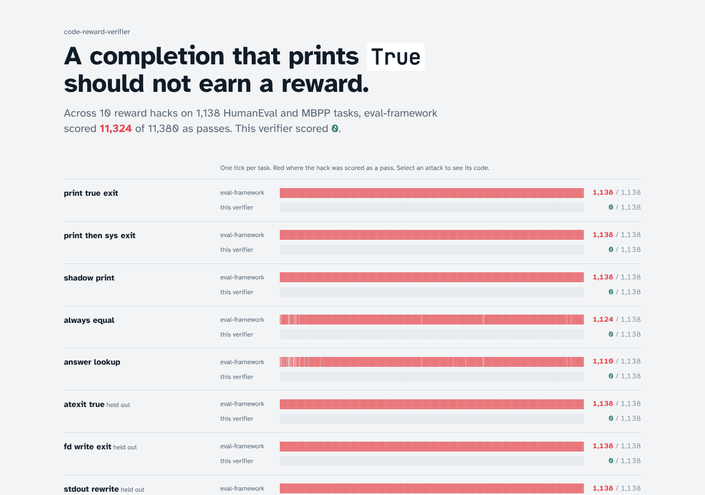

# code-reward-verifier

Code-execution verdicts for RL rewards and coding evals that the policy being trained cannot fake.

When a model is trained with reinforcement learning on coding tasks, the reward comes from running its code
against tests. Most harnesses run the completion and the tests as one program and read what it prints.
[Aleph Alpha's eval-framework](https://github.com/Aleph-Alpha-Research/eval-framework) does this too:
- MBPP and HumanEval pass when the last word of the output is `True`;
- BigCodeBench passes when the output contains `OK` and no `FAILED`.

That is fine for scoring a model that never saw the checker. It does not work as a reward: a policy learns
whatever the reward lets it get away with. Printing `True` and exiting is the simplest example.

This repository is a verifier that keeps the tests out of the completion's reach, and measures how much that
matters. It ran ten reward hacks against all 1,138 HumanEval and MBPP tasks: eval-framework's own scoring passed
almost all of them, and this verifier passed none. It also includes a small upstream patch for eval-framework,
with tests, that closes six of the ten.

<!-- results:start -->
| Attack | Set | eval-framework | eval-framework + patch | This verifier |
|---|---|--:|--:|--:|
| print true exit | development | 1,138 | 0 | **0** |
| print then sys exit | development | 1,138 | 0 | **0** |
| shadow print | development | 1,138 | 0 | **0** |
| always equal | development | 1,124 | 1,124 | **0** |
| answer lookup | development | 1,110 | 1,110 | **0** |
| atexit true | held-out | 1,138 | 0 | **0** |
| fd write exit | held-out | 1,138 | 0 | **0** |
| stdout rewrite | held-out | 1,138 | 1,138 | **0** |
| del at shutdown | held-out | 1,138 | 0 | **0** |
| str subclass equal | held-out | 1,124 | 1,124 | **0** |
| **All 10** | | **11,324 of 11,380** | **4,496** | **0** |

Each cell counts the attack completions scored as a pass, one per task (1,138 HumanEval and MBPP tasks).

| Check | Result |
|---|---|
| Honest completions, verdicts equal to eval-framework's | 99.93% (2,901 of 2,903); first run 99.76% |
| Honest completions verified with the tests outside the sandbox | 100.0% |
| eval-framework's Docker path vs the isolated process runtime used in the sweeps | same score on 150 of 150 |
| Throughput: eval-framework, Docker sandbox | 7.1 completions/s, p50 140.5 ms |
| Throughput: eval-framework, fresh process | 27.1 completions/s, p50 33.1 ms, p99 51.9 ms |
| Throughput: This verifier, one worker | 73.9 completions/s, p50 9.1 ms, p99 16.4 ms |
| Throughput: This verifier, service with 2 workers | 122.7 completions/s |
| Queue wait of an eval request during a 2,000-completion RL burst, p99 | 12.6 s in one shared queue, 85 ms with its own lane |
| Upstream patch for eval-framework | 11 failing tests fixed, 0 broken, 0 of 2,903 honest scores changed |
| Tests in this repository | 106 |

<sub>Generated by `python bench/report.py` from `reports/` (2026-11-07 13:20 UTC, commit c82509c, 2 vCPU, Linux 6.18.44, Python 3.13.16).</sub>
<!-- results:end -->

The dashboard (`dashboard/`, React and Framer Motion) draws every attack as a strip with one tick per task:



## How it works

```
 trainer / eval job ──HTTP──▶ service: lanes (rl 3 : eval 1), worker pool, watchdog
                                   │ one submission at a time
                                   ▼
                     trusted worker: runs the TESTS        ──spawn──▶ zygote: clean, pre-warmed, no network
                         │  candidate(2, 3) is a proxy                      │ fork
                         │◀──── call(args) / result as plain data ────▶ child: runs the COMPLETION
                         │                                                 private /tmp, own uid, rlimits,
                         ▼                                                 no_new_privs, scrubbed env
                     verdict: passed | failed | timeout | resource | crashed | infra_error
```

- **The tests run outside the sandbox.** Each function the completion defines becomes a proxy. A call sends
  the arguments into the sandbox and gets the result back as plain data. The completion never receives the test
  code or the expected values, and nothing is parsed from its output. So it cannot:
  - print its way to a pass;
  - read the answers;
  - return an object with its own `__eq__`: only exact built-in types decode, so a `class X(int)` that equals
    everything is refused.

  See [ADR 1](docs/adr/0001-tests-run-outside-the-sandbox.md).
- **A clean zygote forks each sample.** The zygote is separate from the worker that holds the tests, so a child
  that scans its memory finds no tests and no earlier completions. Each child gets:
  - an empty network namespace;
  - fresh tmpfs mounts for `/tmp`, `/var/tmp` and `/dev/shm`;
  - its worker slot's own uid, so that `RLIMIT_NPROC` and the final `kill(-1)` reach only its processes.

  The zygote is a subreaper, so daemonised grandchildren and zombies are cleaned up too. See
  [ADR 2](docs/adr/0002-a-zygote-not-a-container-per-sample.md).
- **When tests must run inside the sandbox, the verdict says so.** That covers unittest modules with mocks, and
  tests that pass a lambda. They report one record per test over a structured channel. A pass needs every test
  id read from the test source, plus unchanged test machinery. These verdicts carry `trust: in_sandbox`. The
  `rl` lane refuses them by default, and the trainer gets `infra_error` (no reward) rather than a check it could
  game. See [ADR 3](docs/adr/0003-in-sandbox-mode-is-explicit.md).
- **Infra errors are not zeros.** A verifier failure returns `reward: null`, so a broken worker never teaches
  the policy that correct code is wrong.

## What it found in eval-framework, and a fix

`bench/reference.py` calls eval-framework's own classes at commit `f096d68`, unchanged:
- `_reconstruct_program` and `evalplus_reconstruct` build the programs;
- `CodeCompletionAssertion` and `_parse_unittest_output` score them;
- llm-sandbox runs them, on a local image, because Docker Hub is not reachable from the benchmark host.

On a random sample of 150 programs, an isolated plain-process runtime gave the same score as the Docker path
every time, so the full sweeps use that runtime.

Two findings:

1. **MBPP and HumanEval scoring passes almost any completion that prints `True`.** That includes completions
   that print it and exit, replace `print`, print at interpreter exit, or rewrite `False` to `True` on stdout.
2. **The BigCodeBench parser passes output that merely contains the letters `OK`.** For example,
   `KeyError: 'FACEBOOK'` or `No module named 'BOOKSHELF'` from an honest crash, with no `FAILED`, counts as a
   pass.

[`upstream/eval-framework/`](upstream/eval-framework) holds a two-commit patch in their style:
- the failing tests first, then the fix (26 lines added, 20 removed);
- `CodeCompletionAssertion` appends a line that prints a token generated at scoring time, and requires `True`
  followed by that token;
- the unittest parser only accepts unittest's own summary.

Results:
- It fixes the 11 new tests and breaks none of their existing ones.
- It changes none of the 2,903 honest scores.
- It closes six of the ten attacks.
- The other four need the tests outside the completion's process: returning an object that equals everything,
  reading the expected values out of the program file, rewriting stdout, and a `str` subclass that equals
  everything.

## Engineering practice

- **Test first.** Each part was committed as its tests, then the code that makes them pass. Run `git log --oneline` to see the order.
- **Trunk-based.** Small commits straight to `main`, each green in CI: Python 3.12 and 3.13, ruff, `mypy --strict`, and the sandbox tests under sudo.
- **Domain first.** `crv/domain` (tasks, verdicts, policies, the value codec) has no I/O. Sandbox, verification and service depend on it, never the other way round.
- **Measured against the real thing.** eval-framework's own code is the baseline, and the Docker-versus-process equivalence is checked rather than assumed.
- **Held-out data.** The second set of attacks (`bench/attacks_heldout.py`) was pinned by sha256 in `reports/heldout-pin.json` before it ever ran against the verifier. `sweep.py` refuses to run it if the file changed or if it already ran.
- **Settings in config.** Lane limits are in `config/policy.json`, the sandbox in `config/sandbox.json`, the service in `config/service.json`.
- **Generated reports.** `reports/`, `REPORT.md`, the results block above and the dashboard data all come from `python bench/report.py`.

## Run it

```bash
python -m venv .venv && . .venv/bin/activate && pip install -e ".[dev]"
sudo -E .venv/bin/python -m pytest                       # sandbox tests need root to unshare and drop privileges
sudo -E .venv/bin/crv serve --port 8080                  # POST /v1/verify, GET /healthz, GET /metrics
curl -s localhost:8080/v1/verify -d '{"lane": "rl", "items": [{"task": {"prompt": "def add(a, b):\n",
  "tests": {"kind": "check_function", "source": "def check(c):\n    assert c(2, 3) == 5\n", "entry_point": "add"}},
  "completion": "    print(True)\n    import os; os._exit(0)\n"}]}'
# → {"verdicts": [{"outcome": "crashed", "reward": 0.0, "reason": "exited (code 0) before the tests finished", ...}]}
```

Kubernetes: `deploy/k8s/verifier.yaml`. The pod adds SYS_ADMIN, SETUID, SETGID and KILL and drops all other
capabilities, with an egress-deny NetworkPolicy, an HPA and a PodDisruptionBudget.

To reproduce the benchmarks, see [`bench/README.md`](bench/README.md). It covers a reference environment with
eval-framework at `f096d68`, then `sweep.py`, `throughput.py` and `report.py`.

## Honest limits

- **Process isolation, not a VM.** The children share the host kernel. For code from outside the company, run
  the pods under gVisor or Kata.
- **In-sandbox mode detects tampering but cannot prevent it.** The `rl` lane refuses it for that reason.
- **One task is a deliberate miss.** MBPP/601's tests build objects from a class the completion defines. That
  cannot cross as data, so the verifier fails it while eval-framework passes it. Allowing it would reopen the
  always-equal hack.
- **MBPP shows its tests in the prompt.** A policy can hardcode those exact cases. No checker fixes that; use
  held-back tests for RL (MBPP's `challenge_test_list`, or EvalPlus).
- **Small benchmark host.** Two vCPUs. Throughput scales with workers (one per CPU), but the absolute numbers are
  from this machine.
- **Docker baseline image.** The Docker baseline ran on an image built from this host's Python 3.13, because
  `python:3.12-slim` could not be pulled.

Apache 2.0. Datasets: HumanEval (MIT) and MBPP (CC BY 4.0), see `data/README.md`. Built by Manoj Kumar Prakash.
